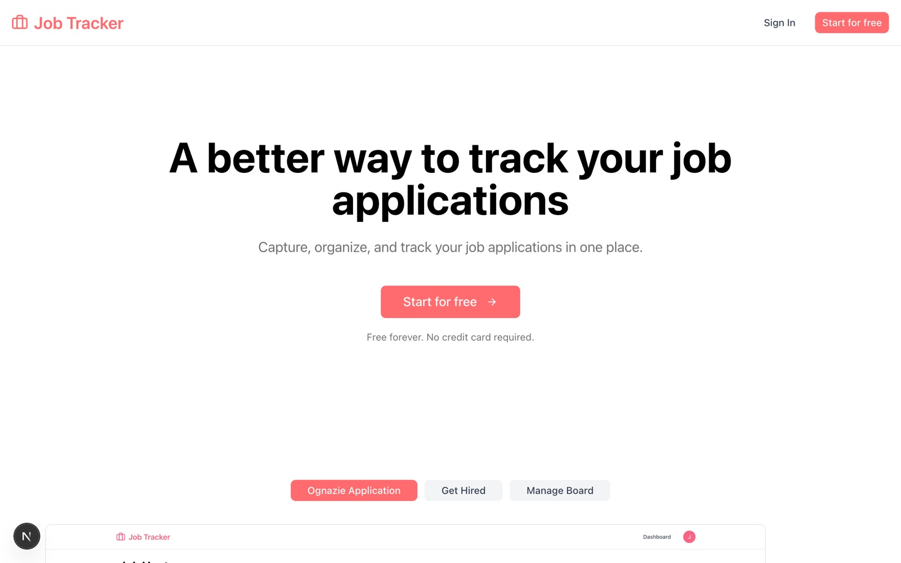

<div align="center">

# 📋 Job Application Tracker

A Next.js app for tracking job applications through every stage, with secure authentication and a personal dashboard.

<a href="https://github.com/miladmo68/Job-Application-Tracker"></a>
<a href="https://miladweb.com"></a>

</div>

<p align="center">
  
</p>

## ✨ Features

- Sign-up and sign-in with Better Auth
- Dashboard to organize applications by status
- MongoDB persistence with Mongoose
- Clean UI built with shadcn/ui and Tailwind CSS

## 🛠️ Tech Stack

     

> [!NOTE]
> This project needs its own backend, database or API keys, so it runs locally rather than as a static demo.

## 🚀 Getting Started

**Prerequisites:** [Node.js](https://nodejs.org/) 18 or newer · A MongoDB database (local or MongoDB Atlas)

**Install and run**

```bash
git clone https://github.com/miladmo68/Job-Application-Tracker.git
cd Job-Application-Tracker
npm install
npm run dev
```

### Environment variables

Create a `.env` file (or `.env.local` for Next.js) with:

```env
MONGODB_URI=
NEXT_PUBLIC_BETTER_AUTH_URL=
```

## 📁 Project Structure

```
Job-Application-Tracker/
├── app/
├── components/
├── lib/
├── public/
├── CLAUDE.md
├── components.json
├── eslint.config.mjs
├── next-env.d.ts
├── next.config.ts
├── package.json
├── postcss.config.mjs
└── tsconfig.json
```

## 👤 Author

**Milad Mohammadi** — Frontend-Focused Full-Stack Developer, Toronto 🇨🇦

[](https://miladweb.com)
[](https://www.linkedin.com/in/miladmo68/)
[](https://github.com/miladmo68)

<p align="center"><sub>If you like this project, consider giving it a ⭐</sub></p>
